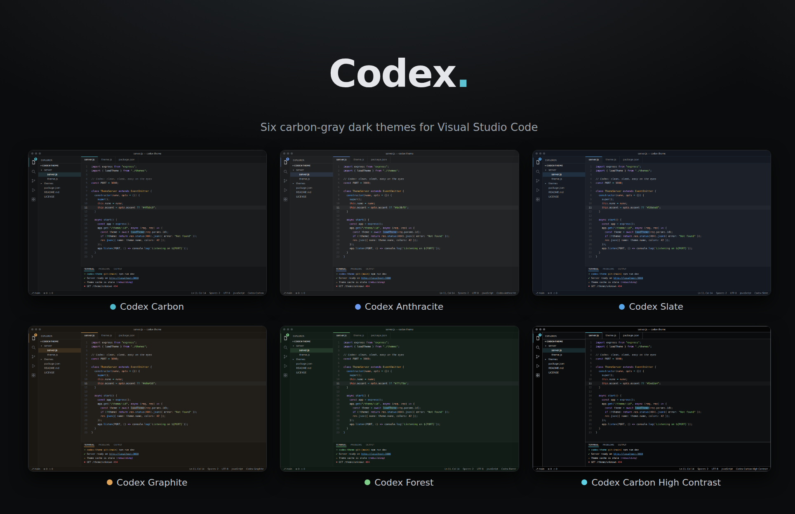
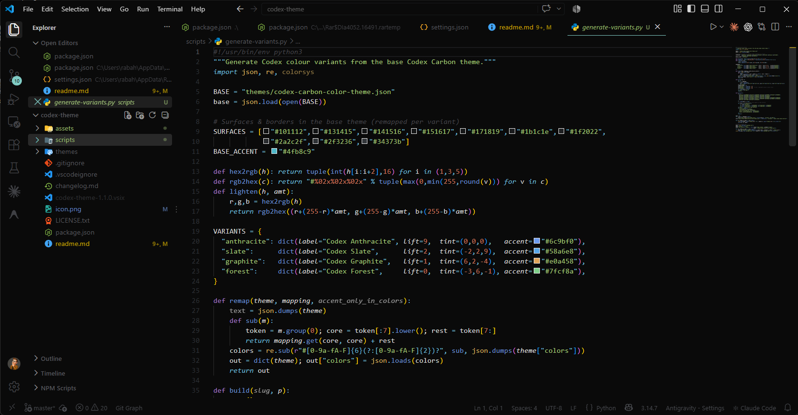
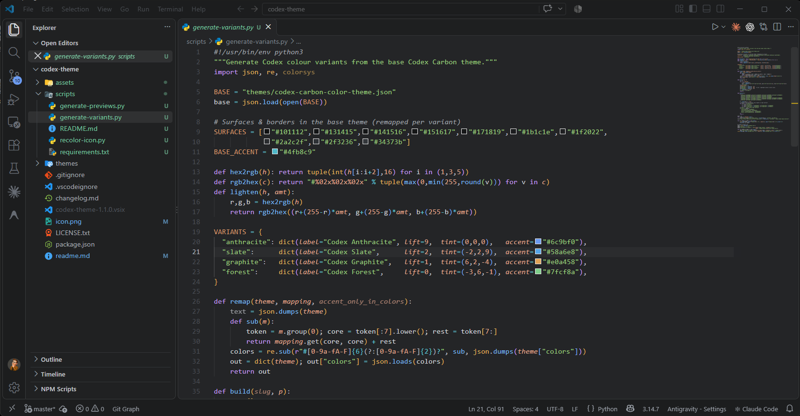
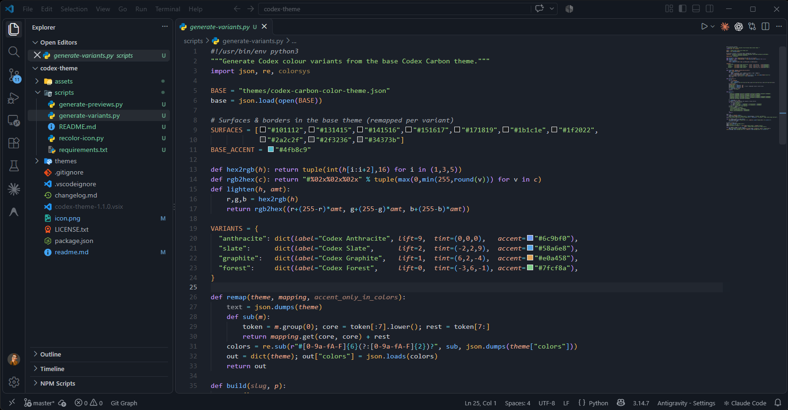
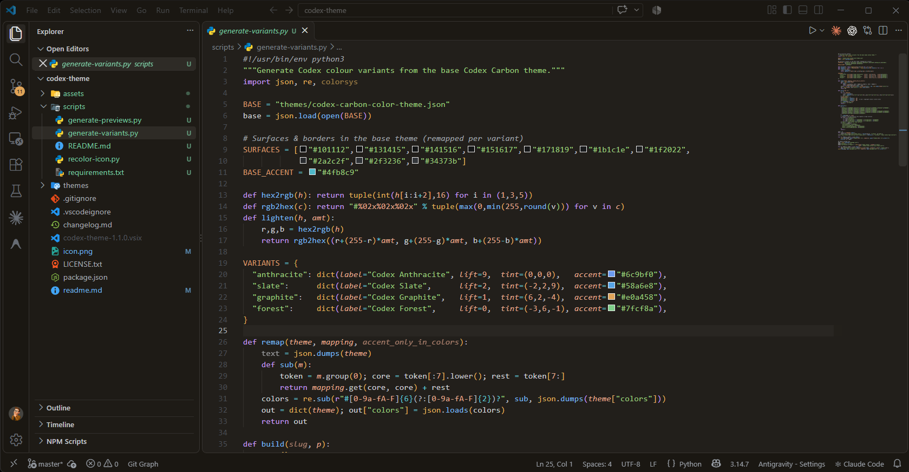
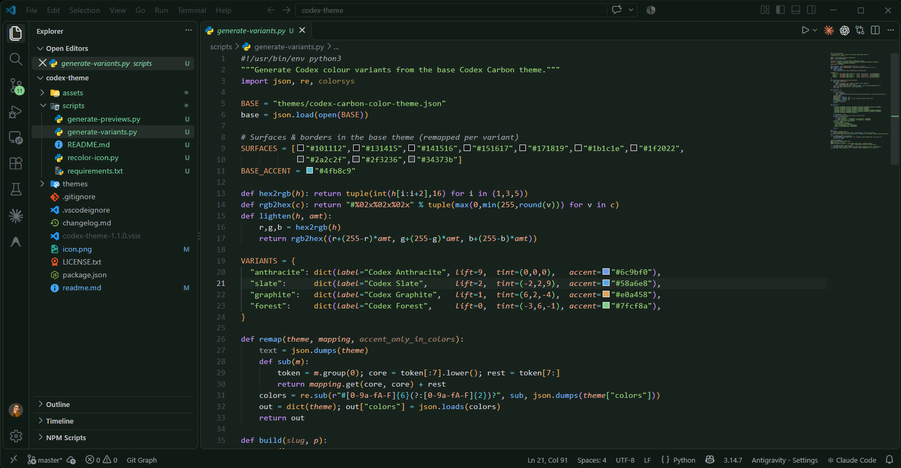
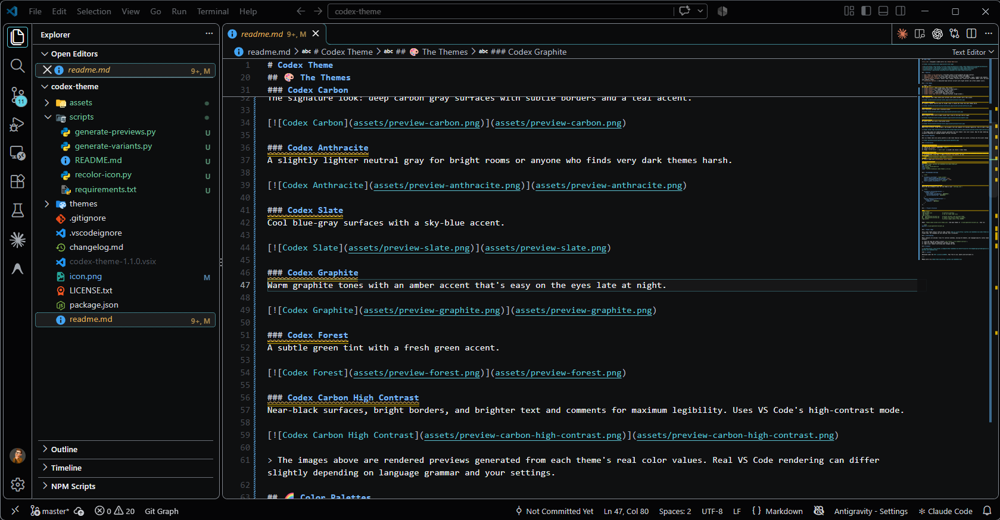
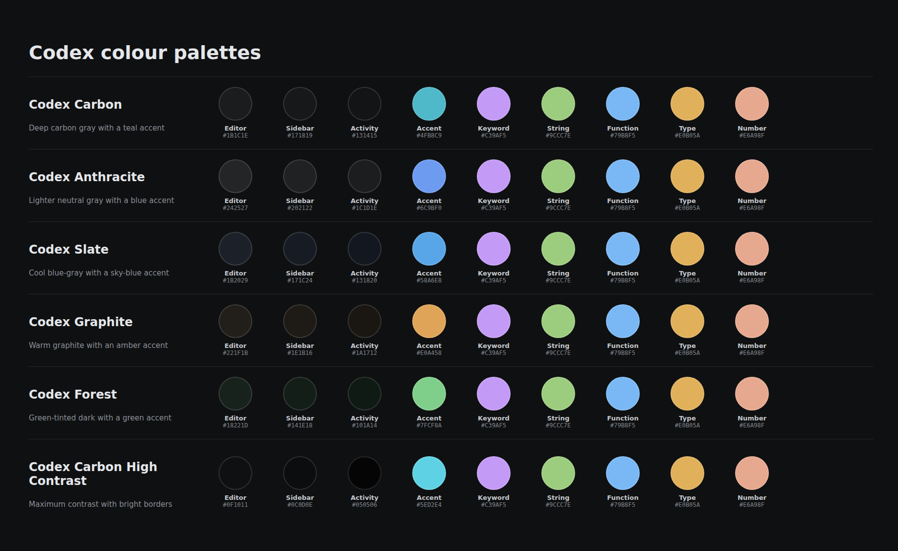

# Codex Theme

**v1.2.0** | Designed & coded with ❤️ by **Rabah Bedirina**

[](assets/cover.png)


## ✨ Features

- **Six themes in one extension**: from deep carbon to warm graphite and high contrast.
- **One accent per theme** for focus rings, the active tab, buttons and badges.
- **Readable syntax colors** with distinct hues for keywords, strings, functions, types, numbers and comments.
- **Full workbench coverage**: editor, tabs, sidebar, activity bar, status bar, terminal (ANSI), diff, git decorations, widgets and semantic tokens.
- **Accessible option**: a dedicated High Contrast variant with bright borders and lifted comment colors.

## 🎨 The Themes

| Theme | Look |
|---|---|
| **Codex Carbon** | Deep carbon gray, teal accent |
| **Codex Anthracite** | Lighter neutral gray, blue accent |
| **Codex Slate** | Cool blue-gray, sky-blue accent |
| **Codex Graphite** | Warm graphite, amber accent |
| **Codex Forest** | Green-tinted dark, green accent |
| **Codex Carbon High Contrast** | Maximum contrast, bright borders |

### Codex Carbon
The signature look: deep carbon gray surfaces with subtle borders and a teal accent.

[](assets/preview-carbon.png)

### Codex Anthracite
A slightly lighter neutral gray for bright rooms or anyone who finds very dark themes harsh.

[](assets/preview-anthracite.png)

### Codex Slate
Cool blue-gray surfaces with a sky-blue accent.

[](assets/preview-slate.png)

### Codex Graphite
Warm graphite tones with an amber accent that's easy on the eyes late at night.

[](assets/preview-graphite.png)

### Codex Forest
A subtle green tint with a fresh green accent.

[](assets/preview-forest.png)

### Codex Carbon High Contrast
Near-black surfaces, bright borders, and brighter text and comments for maximum legibility. Uses VS Code's high-contrast mode.

[](assets/preview-carbon-high-contrast.png)

> The images above are rendered previews generated from each theme's real color values. Real VS Code rendering can differ slightly depending on language grammar and your settings.

## 🌈 Color Palettes

All six themes share one syntax palette so code looks familiar when you switch; surfaces and the accent change per theme.

[](assets/palettes.png)

## 🔧 Installation

### From the Marketplace
1. Open **Extensions** in VS Code (`Ctrl+Shift+X` / `Cmd+Shift+X`).
2. Search for **Codex** (publisher `codex`).
3. Click **Install**.
4. Press `Ctrl+K Ctrl+T` (`Cmd+K Cmd+T` on macOS) and choose a Codex theme.

### From a `.vsix` file
1. Download `codex-theme-1.1.0.vsix` from the [Releases page](https://github.com/rabahbedirina/codex-theme/releases).
2. In Extensions, click the `…` menu → **Install from VSIX…**, or run:
   ```bash
   code --install-extension codex-theme-1.1.0.vsix
   ```
3. Pick a theme with **Preferences: Color Theme**.

### Build it yourself
```bash
git clone https://github.com/rabahbedirina/codex-theme.git
cd codex-theme
npm install -g @vscode/vsce
vsce package
code --install-extension codex-theme-1.1.0.vsix
```

## ⚙️ Recommended Settings

```jsonc
{
  "workbench.colorTheme": "Codex Carbon",
  "editor.semanticHighlighting.enabled": true,
  "editor.bracketPairColorization.enabled": true,
  "editor.guides.bracketPairs": "active"
}
```

### Tweak a color without forking
Override any workbench color for one theme in your `settings.json`:

```jsonc
{
  "workbench.colorCustomizations": {
    "[Codex Carbon]": {
      "activityBar.activeBorder": "#e0b05a",
      "tab.activeBorderTop": "#e0b05a"
    }
  },
  "editor.tokenColorCustomizations": {
    "[Codex Carbon]": {
      "comments": "#80868e"
    }
  }
}
```

## 🛠️ Project Structure

```
codex-theme/
├── package.json                 # extension manifest
├── themes/                      # the six theme JSON files
├── scripts/
│   ├── generate-variants.py     # builds variants from the base theme
│   └── generate-previews.py     # renders the preview images in assets/
└── assets/                      # preview images used in this README
```

Edit `themes/codex-carbon-color-theme.json` (the base theme) or `scripts/generate-variants.py`, then run:

```bash
python3 scripts/generate-variants.py
```

## 🐞 Found a Bug?

If a color looks wrong or hard to read, please [open an issue](https://github.com/rabahbedirina/codex-theme/issues) with the theme name, the language you were editing, and a screenshot.

## 🤝 Contributing

Pull requests are welcome: fixes for contrast problems, missing UI elements, and language-specific syntax tweaks are especially helpful.

1. Fork the repo and create a branch (`git switch -c fix-comment-contrast`).
2. Make your change and regenerate variants if needed.
3. Open a pull request describing what changed and why.

## 🌐 Connect

[](https://github.com/rabahbedirina)

### 📜 License

Released under the [MIT License](LICENSE). Feel free to use, modify and distribute it.

---

Made with ❤️ by [Rabah Bedirina](https://github.com/rabahbedirina)
